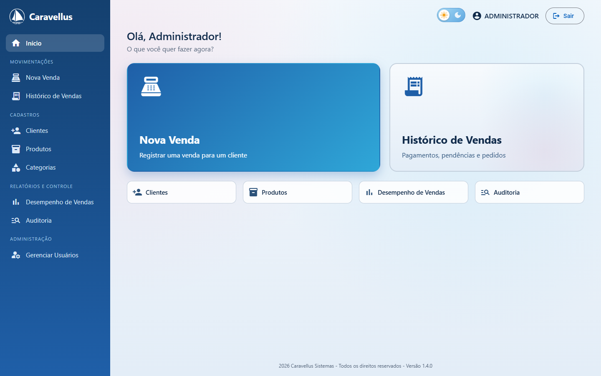
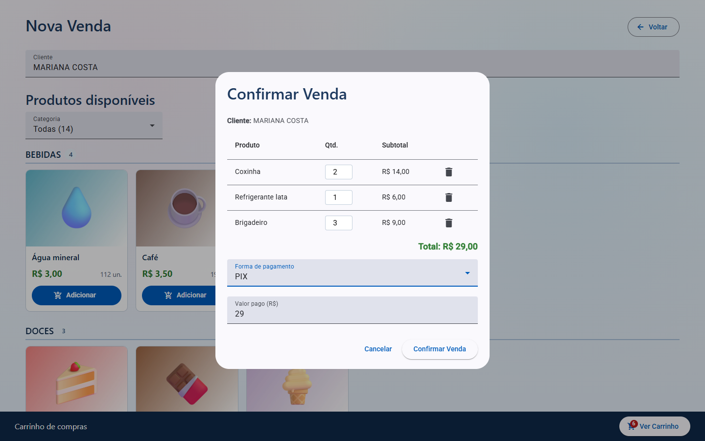
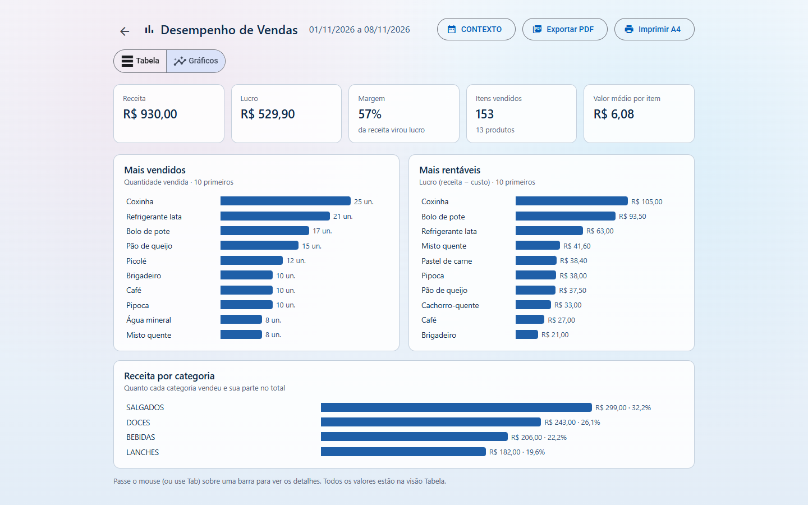
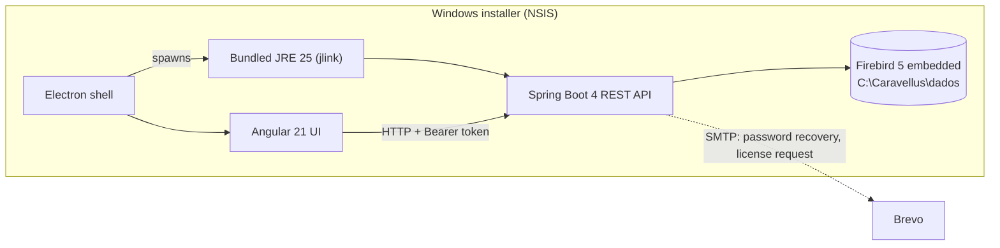

# Caravellus

**Offline-first sales management for event cafeterias** — Java 25 · Spring Boot 4 · embedded Firebird 5 · Angular 21 + Electron

     

**English** · [Português](README.pt-BR.md)

| Home | New sale | Sales performance |
|---|---|---|
|  |  |  |

Caravellus is a Windows desktop app that runs the cafeteria at church camps and conferences: customers, products, sales, stock and running tabs, plus users, auditing and reports. It needs no database server and no installed Java, runs on modest hardware, and works offline. Only password recovery and license requests use the internet.

Current version: **1.4.0**. The user interface is in Brazilian Portuguese; screen names below are given in English with the original in parentheses.

---

## Contents

- [Production use](#production-use)
- [Features](#features)
- [Technical highlights](#technical-highlights)
- [Architecture](#architecture)
- [Project structure](#project-structure)
- [REST API](#rest-api)
- [Data, configuration and licensing](#data-configuration-and-licensing)
- [Tests](#tests)
- [Running locally](#running-locally)

---

## Production use

- **Where:** the cafeteria at camps and conferences, where participants buy throughout the event.
- **How long:** 4 consecutive days, running non-stop for the whole event.
- **Hardware:** a Windows PC with **4 GB of RAM**.
- **Data:** customers are imported straight from the event's Google Forms registration CSV.
- **Payment:** many purchases go on a tab and are settled later.

That environment shaped most of the technical decisions below.

---

## Features

**Home**
- Side menu with every operation grouped by section; New Sale and Sales History highlighted, plus shortcuts. Everything fits the window without scrolling.
- Admin-only options are hidden from operators (the backend blocks them as well).
- Light and dark themes; the brand logo is an SVG that adapts to both.
- A short entrance transition after login (native View Transitions, skipped when the OS asks for reduced motion).

**New sale (Nova Venda)**
- Customer autocomplete that ignores accents; products stay locked until a customer is chosen.
- Products grouped by category, with image, price and available stock (low stock highlighted).
- Cart with change or remaining balance.
- Payment methods: cash, PIX, credit card, debit card, voucher, or **pending** (on a tab).

**Sales history (Histórico de Vendas)**
- Grouped by customer, with filters by period, customer, year and status (pending, paid, credit).
- **Payment spread** across a customer's pending sales, oldest first; any excess becomes credit.
- Edit the items of a sale; delete a sale (admin) with items returned to stock.
- PDF export with a progress bar, and A4 printing.

**Sales performance (Desempenho de Vendas, admin)** — two views of the same period, both exportable to PDF:
- **Table:** quantity, revenue, cost and profit per product, best sellers first.
- **Charts:** period KPIs (revenue, profit, margin, items sold, average value per item), best sellers, most profitable products, revenue by category with share, and a warning for products sold at a loss.

**Customers (Clientes)**
- Create, edit, delete, and view each customer's purchase history.
- Paginated table with Portuguese labels; the pager stays fixed at the bottom of the window.
- **Duplicate warning** (see the rule under *Business rules*). When signing up, "That's me" links the new login to the existing record.
- **CSV import** from Google Forms or the system template, with a preview, all-or-nothing saving and duplicate skipping.
- **Customer → user:** signing up with the CPF of an existing customer creates only the login and keeps the purchase history.

**Products and categories (Produtos, Categorias)**
- Products listed by category, like the sales screen, with a category filter.
- Cost and sale price, stock, "out of stock" shortcut, and an image cropped to 800×600 in the browser before upload.
- Deleting a product or category asks for confirmation.

**Control**
- **Audit log (Auditoria):** sales and their item/payment edits, deletions, products, customers, categories, imports and password events, filtered by user and date.
- **Users (Gerenciar Usuários, admin):** reset passwords and switch roles, with confirmation.
- Brazilian number format throughout the app (R$ 1.234,50).

---

## Technical highlights

**Zero dependencies on the customer's machine**
- The project started on SQL Server. In v1.0.2 it moved to **embedded Firebird 5**, with a custom migration tool for the existing data. The database runs inside the backend process: no DB server to install or maintain.
- The installer ships a **trimmed JRE built with `jlink`** (only the modules the app needs), so users don't install Java either.
- Electron starts the Spring Boot JAR, then loads the Angular UI. The renderer runs with `contextIsolation` on and Node integration off; the preload exposes only three PDF functions.
- Data lives outside the program folder, so updates and uninstalls never delete it. The NSIS installer grants write access to the Users group by SID (`S-1-5-32-545`), which works on Windows in any language.
- When the data folder changed in v1.4.0, the first run copies the old folder automatically:
  - the database is copied last, through a temporary file and an atomic rename, so an interrupted copy never leaves a half-written database;
  - the old folder stays untouched as a backup.

**Schema evolution you can trust**
- Every schema change is a versioned **Flyway** migration (V1–V7).
- Hibernate runs with `ddl-auto=validate`, so a mismatch between entities and schema stops startup instead of corrupting data.

**Security layered in the backend, not the UI**
- Three Spring MVC interceptors guard every `@RestController`:
  - **license** → `423 Locked`;
  - **session** → `401`;
  - `@SomenteAdmin` → `403`.
  
  The Angular app only hides buttons; the API makes the decisions.
- **Server-side sessions:**
  - 256-bit `SecureRandom` tokens;
  - 12 h inactivity timeout;
  - all of a user's sessions are revoked when their role changes or their password is reset;
  - the user who performs an operation always comes from the session, never from the request body.
- **BCrypt** passwords. The default admin must change the password on first login.
- **Password recovery:**
  - 6-digit e-mail code, stored only as a BCrypt hash;
  - single use, valid for 15 minutes;
  - 5 attempts max, and failed attempts are persisted even when the transaction throws (`noRollbackFor`);
  - 60 s minimum between sends.

**Machine-bound licensing with Ed25519**
1. The machine code is derived from the Windows `MachineGuid` and shown in Base32 without the ambiguous characters I, O, 0 and 1.
2. The activation screen e-mails the license request to the vendor.
3. A separate vendor tool (`ferramentas/GeradorLicenca.java`, with a Swing UI and a CLI) signs the license with the private key, keeps an issuance log and e-mails the `.lic` file to the customer.
4. The app holds only the public key, and validation happens in the backend.

**Business rules that came from real use**
- **Running tabs:** a sale can be left pending. A payment is applied to open sales oldest-first, and any excess becomes credit.
- **Price changes** apply only to items of open (pending) sales. Paid sales keep the price they were sold at.
- **Stock is enforced in the backend:**
  - each sale or edit is checked in a single transaction;
  - repeated products are summed;
  - nothing is written if any item is short;
  - editing a sale returns the old items to stock before checking the new ones.
- **Audit log** of every change to sales, payments, products, customers, categories, imports and passwords, each with who and when.
- **Duplicate detection without CPF** (Brazilian tax ID):
  - a match is the same normalized full name, **or** the same phone (last 8 digits) **plus** the same first name;
  - a phone alone is not enough, because siblings and couples often share one.
- **CSV import:** reads the Google Forms export as-is (UTF-8 or Windows-1252, `,` or `;`), shows a preview first and saves all-or-nothing.

**Performance on 4 GB of RAM**
- The sales history loads with a single `JOIN FETCH` query (no N+1), backed by an index on the sale date.
- The UI debounces filters, caches totals and renders accordion panels lazily.
- Charts are plain HTML/CSS (no charting library); colors were validated for contrast and color-blind safety in both themes.
- PDF export uses Electron's `printToPDF` over IPC (no PDF library).
- Each screen is a lazy-loaded chunk (charts and the pager load only with their screens); the initial bundle is about 700 kB.

---

## Architecture



| Layer | Technology |
|---|---|
| Backend | Java 25, Spring Boot 4.0.4 (Web MVC, Data JPA, Mail), Hibernate, Lombok |
| Database | Firebird 5 embedded (Jaybird 6), Flyway |
| Security | Custom interceptors, server-side sessions, BCrypt, Ed25519 (JDK) |
| Frontend | Angular 21.2 (standalone components), Angular Material 21.2, Bootstrap 5.3, ngx-mask |
| Desktop | Electron 41.5, electron-builder, NSIS, JRE 25 trimmed with `jlink` |
| Tests | JUnit 5, Mockito, Spring Boot Test against a real embedded Firebird |

---

## Project structure

```
CaravellusSistemas/
├── backend/                # Spring Boot (Java)
├── frontend/               # Angular + Electron (main.js, preload.js, installer/)
├── ferramentas/
│   └── GeradorLicenca.java # License generator: window + command line (vendor only)
├── gerar-licenca.bat       # Opens the license generator
└── build-release.bat       # Builds the desktop installer
```

**Backend** (`backend/src/main/java/com/caravellus/backend/`)

```
config/        AutenticacaoInterceptor (401/403), LicencaInterceptor (423), LicencaConfig,
               PastaDados (data folder + migration of the old folder), Publico, SomenteAdmin, SecurityConfig
controller/    Auditoria, Categoria, Cliente, Licenca, PeriodoPreferencia, Produto, Spa, Usuario, Venda
dto/  entity/  repository/
service/       Auditoria, Categoria, Cliente, Duplicidade, ImportacaoClientes, Licenca, PeriodoPreferencia,
               Produto, RecuperacaoSenha, Sessao, SolicitacaoLicenca, Usuario, Venda
util/          LeitorCsv, ValidacaoUtil (CPF, e-mail, password)
resources/db/migration/   V1..V7 (Flyway)
```

**Frontend** (`frontend/src/app/`)

```
guards/        licencaGuard, loginGuard, adminGuard
interceptors/  auth (Bearer + 401), licenca (423 → activation screen)
pages/         ativacao, auditoria, cadastro-modal, categorias, clientes, gerenciar-usuarios,
               historico-vendas, home, login, produto-form, vendas,
               relatorio-inventario (Sales performance: table + charts)
shared/        logo, periodo-dialog, rodape-sistema, tema-toggle, paginador-pt
services/  models/  utils/ (number/text helpers, PDF export, image resize, category grouping)
```

---

## REST API

Every endpoint requires `Authorization: Bearer <token>` (returned by login), except the ones marked *public* and `/licenca/**`. Without an active license, everything outside `/licenca/**` returns **423**.

**Authentication (`/auth`)**

| Method | Route | Description | Access |
|---|---|---|---|
| POST | `/auth/login` | Sign in; returns the session token | Public |
| POST | `/auth/logout` | End the session | Signed in |
| POST | `/auth/cadastro` | Sign up (an existing customer's CPF promotes the customer to user) | Public |
| GET | `/auth/cadastro/cliente-por-cpf/{cpf}` | Customer with that CPF (404: new CPF; 409: already a user) | Public |
| POST | `/auth/trocar-senha` | Change password (required on the default admin's first login) | Public |
| POST | `/auth/recuperar-senha/solicitar` | Send a recovery code (`identificador`: login or e-mail) | Public |
| POST | `/auth/recuperar-senha/validar` | Check the code without consuming it | Public |
| POST | `/auth/recuperar-senha/redefinir` | Reset the password with the code | Public |
| GET | `/auth/usuarios` | List users | Admin |
| PATCH | `/auth/usuarios/{id}/reset-senha` | Reset a user's password | Admin |
| PATCH | `/auth/usuarios/{id}/perfil` | Change role (ends the user's sessions) | Admin |

**Customers (`/clientes`)**

| Method | Route | Description |
|---|---|---|
| GET | `/clientes` | List all |
| POST | `/clientes` | Create (409 if a similar record exists; `?confirmarDuplicidade=true` saves anyway) |
| POST | `/clientes/importar` | Import CSV (multipart field `arquivo`); `?confirmar=false` returns the preview only |
| PUT / DELETE | `/clientes/{id}` | Update / delete |

**Products (`/produtos`) and categories (`/categorias`)**

| Method | Route | Description |
|---|---|---|
| GET | `/produtos` | List all (by name) |
| POST / PUT | `/produtos`, `/produtos/{id}` | Create / update (a new price updates only pending sales) |
| DELETE | `/produtos/{id}` | Delete (refused if the product was already sold) |
| GET | `/produtos/{id}/imagem` | Product image (public, long cache; the URL carries a version) |
| PUT / DELETE | `/produtos/{id}/imagem` | Upload (multipart, up to 2 MB) / remove image |
| GET / POST | `/categorias` | List / create |
| PUT / DELETE | `/categorias/{id}` | Update / delete |

**Sales (`/vendas`)**

| Method | Route | Description | Access |
|---|---|---|---|
| POST | `/vendas` | Create a sale (checks stock; 400 with a message if short) | Signed in |
| GET | `/vendas?inicio=&fim=` | List by period (optional ISO dates) | Signed in |
| GET | `/vendas/cliente/{clienteId}` | List by customer | Signed in |
| PATCH | `/vendas/{id}/pagamento` | Update payment (audited) | Signed in |
| PUT | `/vendas/{id}/itens` | Edit items (returns old items to stock, deducts new ones; audited) | Signed in |
| DELETE | `/vendas/{id}` | Delete a sale (items return to stock) | Admin |
| GET | `/vendas/relatorio/inventario?inicio=&fim=` | Sales performance: quantity, revenue, cost and profit per product | Admin |

**Audit, preferences and license**

| Method | Route | Description |
|---|---|---|
| GET | `/auditoria` | Audit log (optional `usuarioId` filter) |
| GET / PUT | `/preferencias/periodo/{tela}` | Last period used on each screen (`periodos.ini`) |
| GET | `/licenca/status` | License status and machine code |
| POST | `/licenca/solicitar` | E-mail the license request to the vendor (name, e-mail, phone + machine code) |
| POST | `/licenca/ativar` | Activate with a license key (`chave`) |

**Roles**

| Role | Access |
|---|---|
| `OPERADOR` (operator) | Sales, sales history, customers, products, categories, audit log |
| `ADMIN` | All of the above + delete sales, sales performance, user management |

---

## Data, configuration and licensing

**Database**
- **Embedded Firebird 5**: it runs inside the backend. The native library comes as a Maven dependency (`jaybird-firebird-embedded-win32-x86-64`), so the backend runs on **Windows x64** only.
- **Data folder** (`CARAVELLUS.FDB`, `config.properties`, `licenca.lic`, `periodos.ini`), resolved in `PastaDados.java`:
  - development: `backend/dados/` (ignored by Git);
  - installed: `C:\Caravellus\dados`, outside the program folder;
  - up to v1.3.3 it was `C:\PortoCabral\dados` with `PORTOCABRAL.FDB`; v1.4.0 copies it over on first run and leaves the old folder as a backup;
  - override with `--app.dados.dir=...` or `APP_DADOS_DIR` (database file only: `--app.db.path` / `APP_DB_PATH`).
- The database is created on first run (UTF8, `UNICODE_CI` collation); the path in use is logged at startup.
- **Schema changes** always go into a new `V<n>__description.sql` migration. Never edit an applied one: Flyway compares checksums and the app won't start.
- **Exclusive access:** in embedded mode only the backend opens the file. Stop it before inspecting the database with an external tool.
- **Default user:** `admin` / `admin` (migration V3), with a mandatory password change on first login. Sign-ups from the login screen are `OPERADOR`.
- **Backup:** stop the app and copy `CARAVELLUS.FDB`.

**Local configuration (outside Git)**
- Per-machine settings live in `config.properties`, in the data folder, loaded if present. Template: [`backend/config.exemplo.properties`](backend/config.exemplo.properties). Another path: `APP_CONFIG_PATH`.

**E-mail (password recovery and license requests)**
- Sent through **Brevo** (`smtp-relay.brevo.com:587`, STARTTLS).
- The sending account is embedded in the JAR from `backend/src/main/resources/email-padrao.properties`, which is kept out of Git (template: [`backend/email-padrao.exemplo.properties`](backend/email-padrao.exemplo.properties)). `build-release.bat` refuses to build without it.
- The SMTP key can only send mail; if it leaks, revoke it in Brevo. A customer can use another account through `config.properties`.

**License activation**
1. On first run, the activation screen shows the **machine code** (`XXXX-XXXX-XXXX-XXXX`) and lets the customer e-mail a license request.
2. The vendor generates the key in the **license generator** (`gerar-licenca.bat`), which copies it to the clipboard and can e-mail the license file. Command line: `gerar-licenca.bat "Customer name" XXXX-XXXX-XXXX-XXXX [folder]`.
3. The customer imports the license file (or pastes the key). It is stored as `licenca.lic` in the data folder and checked on every startup.

- The key is **signed with Ed25519**; the app has only the public key (`LicencaService.CHAVE_PUBLICA`).
- It is valid **for that machine only** and never expires. Reinstalling Windows or changing computers requires a new key.
- The license file keeps the old product name in its delimiters (`-----BEGIN PORTO CABRAL LICENCA-----`) on purpose: changing them would invalidate issued licenses.
- **Vendor private key:** created once with `gerar-licenca.bat chaves`, stored in `%USERPROFILE%\.portocabral\licenca-privada.key` (or `PORTOCABRAL_CHAVE_PRIVADA`). Back it up and **never** commit it or ship it. Every issued key is logged in `licencas-emitidas.csv` next to it.

**Data model**

```
PESSOA ──────┬── USUARIO ── RECUPERACAO_SENHA
             └── CLIENTE ── VENDA ── VENDA_ITEM ── PRODUTO ── CATEGORIA
                                                      └── PRODUTO_IMAGEM
AUDITORIA_LOG (user, operation type, description, timestamp)
```

---

## Tests

49 tests. Integration tests run against a real embedded Firebird database in `target/test-dados`, which Flyway creates on the first run; the mail sender is mocked. They cover:

- **Sales:** stock deduction and return, insufficient stock with full rollback, repeated products, editing items, deleting sales, price changes applied only to pending sales, and the audit trail.
- **Password recovery:** code e-mailed, hash-only storage, single use, attempt limit and resend interval.
- **Sessions:** token generation, logout, and revocation of all of a user's sessions.
- **Licensing:** signature, machine binding, file format and tampering.
- **Duplicate detection, CSV parsing, phone normalization**, and the migration of the data folder.

```bash
cd backend
./mvnw test        # Windows x64 (the embedded Firebird ships native Windows libraries)
```

---

## Running locally

```bash
# Backend (http://localhost:8080) — data in backend/dados/
cd backend && ./mvnw spring-boot:run

# Frontend (http://localhost:4200)
cd frontend && npm install && npm start

# Desktop shell: loads the Angular build in frontend/dist (run `npx ng build` first);
# outside the installer it does not start the backend, so keep the backend running
cd frontend && npm run electron
```

On first run the activation screen asks for a license (see *License activation*). The default user is `admin` / `admin`, and the app requires a password change on first login.

**Installer:** `build-release.bat` builds Angular, packs it into the Spring Boot JAR and runs electron-builder. Output: `electron\Caravellus<version>`. It requires:
- `electron/resources/jre-min`, a JRE 25 created with `jlink`;
- a filled-in `backend/src/main/resources/email-padrao.properties`.
