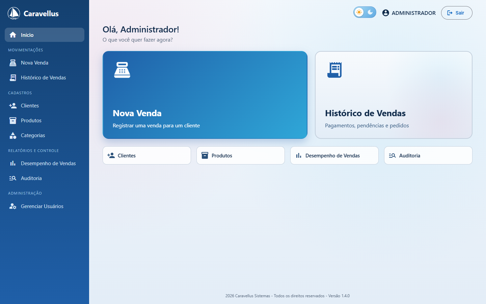
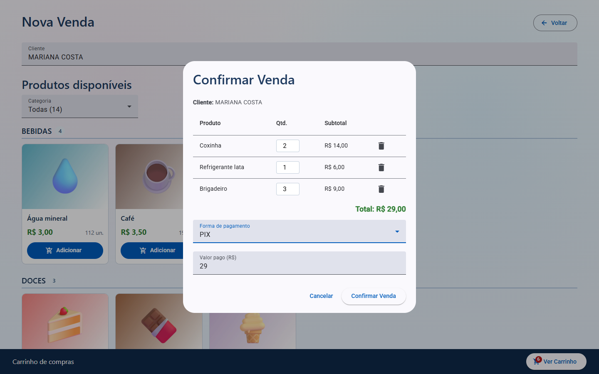
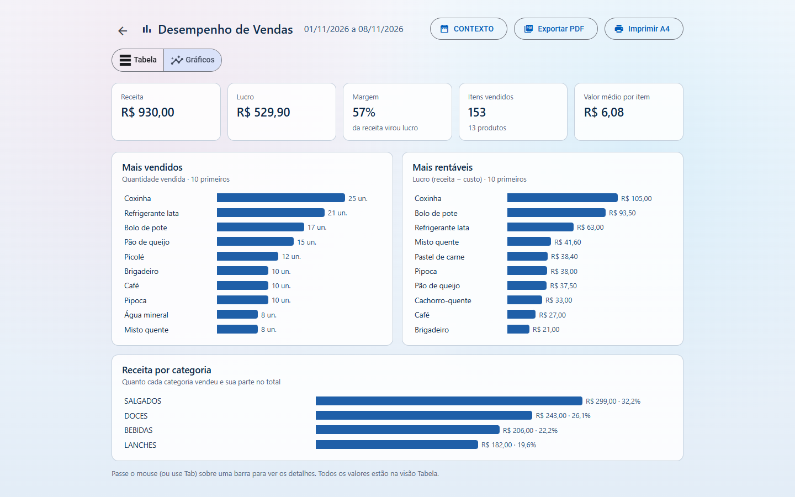
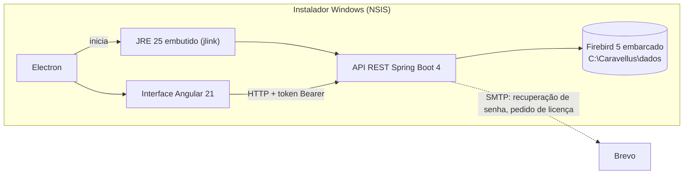

# Caravellus

**Gestão de vendas offline para cantinas de eventos** — Java 25 · Spring Boot 4 · Firebird 5 embarcado · Angular 21 + Electron

     

[English](README.md) · **Português**

| Tela inicial | Nova venda | Desempenho de vendas |
|---|---|---|
|  |  |  |

O Caravellus é um aplicativo desktop para Windows que gerencia a cantina de acampamentos e conferências: clientes, produtos, vendas, estoque e contas em aberto, além de usuários, auditoria e relatórios. Não precisa de servidor de banco nem de Java instalado, roda em computador modesto e funciona sem internet. Só a recuperação de senha e o pedido de licença usam a rede.

Versão atual: **1.5.0**.

---

## Sumário

- [Uso em produção](#uso-em-produção)
- [Funcionalidades](#funcionalidades)
- [Destaques técnicos](#destaques-técnicos)
- [Arquitetura](#arquitetura)
- [Estrutura do projeto](#estrutura-do-projeto)
- [API REST](#api-rest)
- [Dados, configuração e licença](#dados-configuração-e-licença)
- [Testes](#testes)
- [Executar localmente](#executar-localmente)

---

## Uso em produção

- **Onde:** na cantina de acampamentos e conferências, onde os participantes compram ao longo do evento.
- **Quanto tempo:** 4 dias seguidos, ligado sem parar durante todo o evento.
- **Máquina:** um PC com Windows e **4 GB de RAM**.
- **Cadastro:** os participantes vêm direto do CSV de inscrição do Google Forms.
- **Pagamento:** boa parte das compras fica "na conta" para acertar depois.

Esse cenário guiou a maior parte das decisões técnicas abaixo.

---

## Funcionalidades

**Tela inicial**
- Menu lateral com todas as operações agrupadas por seção; Nova Venda e Histórico de Vendas em destaque, mais atalhos. Tudo cabe na janela, sem rolagem.
- Opções de administrador ficam ocultas para operadores (e o backend também as bloqueia).
- Temas claro e escuro; a logo é um SVG que se adapta aos dois.
- Uma transição curta de entrada após o login (View Transitions nativas, desligada quando o Windows pede menos animação).

**Nova Venda**
- Busca de cliente que ignora acentos; os produtos só ficam liberados depois de escolher o cliente.
- Produtos agrupados por categoria, com imagem, preço e estoque disponível (estoque baixo em destaque).
- Carrinho com troco ou saldo pendente.
- Formas de pagamento: dinheiro, PIX, cartão de crédito, cartão de débito, voucher ou **pendente** (fiado).

**Histórico de Vendas**
- Agrupado por cliente, com filtros por período, cliente, ano e situação (pendente, quitado, crédito).
- **Pagamento distribuído** entre as vendas pendentes do cliente, da mais antiga para a mais nova; o excedente vira crédito.
- Edição dos itens de uma venda; exclusão de venda (ADMIN) com devolução dos itens ao estoque.
- Exportação em PDF com barra de progresso e impressão em A4.

**Desempenho de Vendas (ADMIN)** — duas visões do mesmo período, ambas exportáveis em PDF:
- **Tabela:** quantidade, receita, custo e lucro por produto, do mais vendido ao menos vendido.
- **Gráficos:** indicadores do período (receita, lucro, margem, itens vendidos, valor médio por item), mais vendidos, mais rentáveis, receita por categoria com a participação no total e aviso de produtos vendidos com prejuízo.

**Clientes**
- Cadastro, edição, exclusão e histórico de compras de cada cliente.
- Tabela paginada em português, com o paginador fixo no rodapé da janela.
- **Aviso de cadastro duplicado** (veja a regra em *Regras de negócio*). No cadastro de usuário, "Sou eu" liga o novo acesso ao cadastro que já existia.
- **Importação de CSV** do Google Forms ou do modelo do sistema, com prévia, gravação tudo-ou-nada e cadastros repetidos ignorados.
- **Cliente → usuário:** cadastrar-se com o CPF de um cliente existente cria só o acesso e mantém o histórico de compras.

**Produtos e Categorias**
- Produtos listados por categoria, como na tela de vendas, com filtro de categoria.
- Preço de custo e de venda, estoque, atalho "sem estoque" e imagem recortada para 800×600 no navegador antes do envio.
- Excluir produto ou categoria pede confirmação.

**Controle**
- **Auditoria:** vendas e suas edições de itens e de pagamento, exclusões, produtos, clientes, categorias, importações e eventos de senha, com filtros por usuário e data.
- **Gerenciar Usuários (ADMIN):** redefinir senha e trocar perfil, com confirmação.
- Valores no formato brasileiro em todo o app (R$ 1.234,50).

---

## Destaques técnicos

**Nenhuma dependência na máquina do cliente**
- O projeto começou em SQL Server. Na v1.0.2 passou para **Firebird 5 embarcado**, com uma ferramenta própria para migrar os dados existentes. O banco roda dentro do processo do backend: nada de servidor de banco para instalar ou manter.
- O instalador leva um **JRE reduzido, gerado com `jlink`** (só os módulos que o app usa), então o usuário também não instala Java.
- O Electron sobe o JAR do Spring Boot e depois carrega a interface Angular. A janela roda com `contextIsolation` ligado e sem integração com o Node; o preload expõe só três funções de PDF.
- Os dados ficam fora da pasta do programa, então atualizar ou desinstalar não os apaga. O instalador NSIS libera escrita para o grupo Usuários pelo SID (`S-1-5-32-545`), o que funciona em Windows de qualquer idioma.
- Quando a pasta de dados mudou, na v1.4.0, a primeira execução copia a pasta antiga automaticamente:
  - o banco é copiado por último, via arquivo temporário e renomeação atômica, para que uma cópia interrompida nunca deixe um banco pela metade;
  - a pasta antiga fica intacta, como backup.

**Evolução segura do banco**
- Toda mudança de estrutura é uma migration **Flyway** versionada (V1–V7).
- O Hibernate roda com `ddl-auto=validate`: se as entidades e o banco não baterem, o sistema não sobe, em vez de corromper dados.

**Segurança em camadas no backend, não na tela**
- Três interceptors do Spring MVC protegem todos os `@RestController`:
  - **licença** → `423 Locked`;
  - **sessão** → `401`;
  - `@SomenteAdmin` → `403`.
  
  O Angular só esconde botões; quem decide é a API.
- **Sessões no servidor:**
  - tokens de 256 bits gerados com `SecureRandom`;
  - expiram após 12 h sem uso;
  - todas as sessões do usuário caem quando o perfil muda ou a senha é redefinida;
  - quem fez a operação vem sempre da sessão, nunca do corpo da requisição.
- Senhas com **BCrypt**. O administrador padrão é obrigado a trocar a senha no primeiro login.
- **Recuperação de senha:**
  - código de 6 dígitos por e-mail, guardado só como hash BCrypt;
  - uso único, válido por 15 minutos;
  - no máximo 5 tentativas, e as erradas ficam gravadas mesmo quando a transação lança exceção (`noRollbackFor`);
  - novo envio só após 60 segundos.

**Licença presa à máquina, com Ed25519**
1. O código da máquina vem do `MachineGuid` do Windows e é exibido em Base32 sem os caracteres ambíguos I, O, 0 e 1.
2. A tela de ativação envia o pedido de licença por e-mail ao fornecedor.
3. Uma ferramenta separada do fornecedor (`ferramentas/GeradorLicenca.java`, com janela Swing e linha de comando) assina a licença com a chave privada, registra o histórico de emissões e envia o arquivo `.lic` por e-mail ao cliente.
4. O app tem só a chave pública, e a validação acontece no backend.

**Regras de negócio que vieram do uso real**
- **Venda fiado:** a venda pode ficar pendente. O pagamento quita as vendas em aberto da mais antiga para a mais nova, e o excedente vira crédito.
- **Mudança de preço** vale só para os itens de vendas em aberto (pendentes). Vendas quitadas mantêm o preço em que foram vendidas.
- **Estoque conferido no backend:**
  - cada venda ou edição é conferida numa única transação;
  - o mesmo produto repetido na lista é somado;
  - nada é gravado se faltar estoque de algum item;
  - ao editar uma venda, os itens antigos voltam ao estoque antes de conferir os novos.
- **Auditoria** de toda alteração em vendas, pagamentos, produtos, clientes, categorias, importações e senhas, com quem fez e quando.
- **Detecção de duplicados sem CPF:**
  - é duplicado o mesmo nome completo (ignorando acentos, maiúsculas e espaços) **ou** o mesmo celular (últimos 8 dígitos) **com** o mesmo primeiro nome;
  - o celular sozinho não basta, porque irmãos e casais costumam compartilhar o número.
- **Importação de CSV:** lê a exportação do Google Forms como veio (UTF-8 ou Windows-1252, `,` ou `;`), mostra uma prévia e grava tudo ou nada.

**Desempenho em 4 GB de RAM**
- O histórico de vendas carrega com uma única consulta `JOIN FETCH` (sem N+1), apoiada num índice na data da venda.
- A interface usa debounce nos filtros, guarda os totais em cache e só renderiza os painéis quando são abertos.
- Os gráficos são HTML/CSS puro (sem biblioteca de gráficos), com cores validadas quanto a contraste e daltonismo nos dois temas.
- A exportação em PDF usa o `printToPDF` do Electron via IPC (sem biblioteca de PDF).
- Cada tela é carregada sob demanda (os gráficos e o paginador só carregam com as suas telas); o carregamento inicial tem cerca de 700 kB.

---

## Arquitetura



| Camada | Tecnologia |
|---|---|
| Backend | Java 25, Spring Boot 4.0.4 (Web MVC, Data JPA, Mail), Hibernate, Lombok |
| Banco de dados | Firebird 5 embarcado (Jaybird 6), Flyway |
| Segurança | Interceptors próprios, sessões no servidor, BCrypt, Ed25519 (JDK) |
| Frontend | Angular 21.2 (standalone components), Angular Material 21.2, Bootstrap 5.3, ngx-mask |
| Desktop | Electron 41.5, electron-builder, NSIS, JRE 25 reduzido com `jlink` |
| Testes | JUnit 5, Mockito, Spring Boot Test com Firebird embarcado real |

---

## Estrutura do projeto

```
CaravellusSistemas/
├── backend/                # Spring Boot (Java)
├── frontend/               # Angular + Electron (main.js, preload.js, installer/)
├── ferramentas/
│   └── GeradorLicenca.java # Gerador de licenças: janela + linha de comando (uso do fornecedor)
├── gerar-licenca.bat       # Abre o gerador de licenças
└── build-release.bat       # Gera o instalador do app desktop
```

**Backend** (`backend/src/main/java/com/caravellus/backend/`)

```
config/        AutenticacaoInterceptor (401/403), LicencaInterceptor (423), LicencaConfig,
               PastaDados (pasta de dados + migração da pasta antiga), Publico, SomenteAdmin, SecurityConfig
controller/    Auditoria, Categoria, Cliente, Licenca, PeriodoPreferencia, Produto, Spa, Usuario, Venda
dto/  entity/  repository/
service/       Auditoria, Categoria, Cliente, Duplicidade, ImportacaoClientes, Licenca, PeriodoPreferencia,
               Produto, RecuperacaoSenha, Sessao, SolicitacaoLicenca, Usuario, Venda
util/          LeitorCsv, ValidacaoUtil (CPF, e-mail, senha)
resources/db/migration/   V1..V7 (Flyway)
```

**Frontend** (`frontend/src/app/`)

```
guards/        licencaGuard, loginGuard, adminGuard
interceptors/  auth (Bearer + 401), licenca (423 → tela de ativação)
pages/         ativacao, auditoria, cadastro-modal, categorias, clientes, gerenciar-usuarios,
               historico-vendas, home, login, produto-form, vendas,
               relatorio-inventario (Desempenho de Vendas: tabela + gráficos)
shared/        logo, periodo-dialog, rodape-sistema, tema-toggle, paginador-pt
services/  models/  utils/ (formatação, exportação em PDF, redução de imagem, agrupamento por categoria)
```

---

## API REST

Todos os endpoints exigem `Authorization: Bearer <token>` (recebido no login), exceto os marcados como *pública* e `/licenca/**`. Sem licença ativa, tudo fora de `/licenca/**` responde **423**.

**Autenticação (`/auth`)**

| Método | Rota | Descrição | Acesso |
|---|---|---|---|
| POST | `/auth/login` | Entrar; devolve o token da sessão | Pública |
| POST | `/auth/logout` | Encerrar a sessão | Logado |
| POST | `/auth/cadastro` | Cadastrar usuário (CPF de cliente existente promove o cliente a usuário) | Pública |
| GET | `/auth/cadastro/cliente-por-cpf/{cpf}` | Cliente com esse CPF (404: CPF novo; 409: já é usuário) | Pública |
| POST | `/auth/trocar-senha` | Trocar a senha (obrigatório no primeiro login do admin padrão) | Pública |
| POST | `/auth/recuperar-senha/solicitar` | Enviar código de recuperação (`identificador`: login ou e-mail) | Pública |
| POST | `/auth/recuperar-senha/validar` | Conferir o código sem consumi-lo | Pública |
| POST | `/auth/recuperar-senha/redefinir` | Redefinir a senha com o código | Pública |
| GET | `/auth/usuarios` | Listar usuários | ADMIN |
| PATCH | `/auth/usuarios/{id}/reset-senha` | Redefinir a senha de um usuário | ADMIN |
| PATCH | `/auth/usuarios/{id}/perfil` | Alterar perfil (encerra as sessões do usuário) | ADMIN |

**Clientes (`/clientes`)**

| Método | Rota | Descrição |
|---|---|---|
| GET | `/clientes` | Listar todos |
| POST | `/clientes` | Criar (409 se houver cadastro parecido; `?confirmarDuplicidade=true` grava mesmo assim) |
| POST | `/clientes/importar` | Importar CSV (multipart, campo `arquivo`); `?confirmar=false` devolve só a prévia |
| PUT / DELETE | `/clientes/{id}` | Atualizar / excluir |

**Produtos (`/produtos`) e Categorias (`/categorias`)**

| Método | Rota | Descrição |
|---|---|---|
| GET | `/produtos` | Listar todos (por nome) |
| POST / PUT | `/produtos`, `/produtos/{id}` | Criar / atualizar (preço novo reajusta só vendas pendentes) |
| DELETE | `/produtos/{id}` | Excluir (recusado se o produto já foi vendido) |
| GET | `/produtos/{id}/imagem` | Imagem do produto (pública, cache longo; a URL leva a versão) |
| PUT / DELETE | `/produtos/{id}/imagem` | Enviar (multipart, até 2 MB) / remover imagem |
| GET / POST | `/categorias` | Listar / criar |
| PUT / DELETE | `/categorias/{id}` | Atualizar / excluir |

**Vendas (`/vendas`)**

| Método | Rota | Descrição | Acesso |
|---|---|---|---|
| POST | `/vendas` | Realizar venda (confere o estoque; 400 com a mensagem se faltar) | Logado |
| GET | `/vendas?inicio=&fim=` | Listar por período (datas ISO, opcionais) | Logado |
| GET | `/vendas/cliente/{clienteId}` | Listar por cliente | Logado |
| PATCH | `/vendas/{id}/pagamento` | Atualizar pagamento (auditado) | Logado |
| PUT | `/vendas/{id}/itens` | Editar itens (devolve os antigos ao estoque e baixa os novos; auditado) | Logado |
| DELETE | `/vendas/{id}` | Excluir venda (itens voltam ao estoque) | ADMIN |
| GET | `/vendas/relatorio/inventario?inicio=&fim=` | Desempenho de vendas: quantidade, receita, custo e lucro por produto | ADMIN |

**Auditoria, preferências e licença**

| Método | Rota | Descrição |
|---|---|---|
| GET | `/auditoria` | Registros de auditoria (filtro opcional `usuarioId`) |
| GET / PUT | `/preferencias/periodo/{tela}` | Último período usado em cada tela (`periodos.ini`) |
| GET | `/licenca/status` | Situação da licença e código da máquina |
| POST | `/licenca/solicitar` | Enviar o pedido de licença ao fornecedor (nome, e-mail, telefone + código da máquina) |
| POST | `/licenca/ativar` | Ativar com a chave de licença (`chave`) |

**Perfis**

| Perfil | Acesso |
|---|---|
| `OPERADOR` | Vendas, histórico de vendas, clientes, produtos, categorias, auditoria |
| `ADMIN` | Tudo acima + excluir vendas, desempenho de vendas, gerenciar usuários |

---

## Dados, configuração e licença

**Banco de dados**
- **Firebird 5 embarcado**: roda dentro do backend. A biblioteca nativa vem como dependência Maven (`jaybird-firebird-embedded-win32-x86-64`), então o backend só roda em **Windows x64**.
- **Pasta de dados** (`CARAVELLUS.FDB`, `config.properties`, `licenca.lic`, `periodos.ini`), definida em `PastaDados.java`:
  - desenvolvimento: `backend/dados/` (ignorada pelo Git);
  - sistema instalado: `C:\Caravellus\dados`, fora da pasta do programa;
  - até a v1.3.3 era `C:\PortoCabral\dados`, com `PORTOCABRAL.FDB`; a v1.4.0 copia tudo de lá na primeira execução e deixa a pasta antiga como backup;
  - outro local: `--app.dados.dir=...` ou `APP_DADOS_DIR` (só o arquivo do banco: `--app.db.path` / `APP_DB_PATH`).
- O banco é criado na primeira execução (UTF8, collation `UNICODE_CI`), e o caminho em uso aparece no log ao iniciar.
- **Mudança de estrutura** sempre vira uma nova migration `V<n>__descricao.sql`. Nunca altere uma já aplicada: o Flyway compara o checksum e o sistema não sobe.
- **Acesso exclusivo:** no modo embarcado, só o backend abre o arquivo. Pare-o antes de abrir o banco numa ferramenta externa.
- **Usuário padrão:** `admin` / `admin` (migration V3), com troca de senha obrigatória no primeiro login. Cadastros feitos pela tela de login entram como `OPERADOR`.
- **Backup:** pare o sistema e copie o `CARAVELLUS.FDB`.

**Configuração local (fora do Git)**
- Ajustes por máquina ficam em `config.properties`, na pasta de dados, carregado se existir. Modelo: [`backend/config.exemplo.properties`](backend/config.exemplo.properties). Outro caminho: `APP_CONFIG_PATH`.

**E-mail (recuperação de senha e pedido de licença)**
- Enviado pelo **Brevo** (`smtp-relay.brevo.com:587`, STARTTLS).
- A conta de envio vai embutida no JAR, a partir de `backend/src/main/resources/email-padrao.properties`, que fica fora do Git (modelo: [`backend/email-padrao.exemplo.properties`](backend/email-padrao.exemplo.properties)). O `build-release.bat` não gera o instalador sem ele.
- A chave SMTP só permite enviar; se vazar, basta revogá-la no Brevo. Um cliente pode usar outra conta pelo `config.properties`.

**Ativação da licença**
1. Na primeira execução, a tela de ativação mostra o **código da máquina** (`XXXX-XXXX-XXXX-XXXX`) e permite enviar o pedido de licença por e-mail.
2. O fornecedor gera a chave no **Gerador de Licenças** (`gerar-licenca.bat`), que a copia para a área de transferência e pode enviar o arquivo de licença por e-mail. Pela linha de comando: `gerar-licenca.bat "Nome do cliente" XXXX-XXXX-XXXX-XXXX [pasta]`.
3. O cliente importa o arquivo de licença (ou cola a chave). Ela fica em `licenca.lic`, na pasta de dados, e é conferida a cada inicialização.

- A chave é **assinada com Ed25519**; o app tem só a chave pública (`LicencaService.CHAVE_PUBLICA`).
- Vale **só para aquela máquina** e não expira. Reinstalar o Windows ou trocar de computador exige uma nova chave.
- O arquivo de licença mantém o nome antigo do produto nos delimitadores (`-----BEGIN PORTO CABRAL LICENCA-----`) de propósito: mudá-los invalidaria as licenças já emitidas.
- **Chave privada do fornecedor:** criada uma única vez com `gerar-licenca.bat chaves`, fica em `%USERPROFILE%\.portocabral\licenca-privada.key` (ou em `PORTOCABRAL_CHAVE_PRIVADA`). Faça backup e **nunca** a coloque no Git ou no instalador. Toda chave emitida fica registrada em `licencas-emitidas.csv`, na mesma pasta.

**Modelo de dados**

```
PESSOA ──────┬── USUARIO ── RECUPERACAO_SENHA
             └── CLIENTE ── VENDA ── VENDA_ITEM ── PRODUTO ── CATEGORIA
                                                      └── PRODUTO_IMAGEM
AUDITORIA_LOG (usuário, tipo de operação, descrição, data/hora)
```

---

## Testes

São 51 testes. Os de integração rodam contra um Firebird embarcado real em `target/test-dados`, criado pelo Flyway na primeira execução; o envio de e-mail é simulado. Eles cobrem:

- **Vendas:** baixa e devolução de estoque, estoque insuficiente com rollback completo, produto repetido, edição de itens, exclusão de venda, preço novo aplicado só a vendas pendentes, isolamento entre eventos e registro na auditoria.
- **Recuperação de senha:** código enviado por e-mail, armazenamento só do hash, uso único, limite de tentativas e intervalo entre envios.
- **Sessões:** geração de token, logout e derrubada de todas as sessões do usuário.
- **Licença:** assinatura, vínculo com a máquina, formato do arquivo e adulteração.
- **Detecção de duplicados, leitura de CSV, normalização de telefone** e migração da pasta de dados.

```bash
cd backend
./mvnw test        # Windows x64 (o Firebird embarcado traz bibliotecas nativas do Windows)
```

---

## Executar localmente

```bash
# Backend (http://localhost:8080) — dados em backend/dados/
cd backend && ./mvnw spring-boot:run

# Frontend (http://localhost:4200)
cd frontend && npm install && npm start

# App desktop: carrega o build do Angular em frontend/dist (rode `npx ng build` antes);
# fora do instalador ele não sobe o backend, então mantenha o backend rodando
cd frontend && npm run electron
```

Na primeira execução, a tela de ativação pede a licença (veja *Ativação da licença*). O usuário padrão é `admin` / `admin`, e o sistema exige a troca da senha no primeiro login.

**Instalador:** o `build-release.bat` gera o build do Angular, embute no JAR do Spring Boot e roda o electron-builder. Saída: `electron\Caravellus<versão>`. Requisitos:
- `electron/resources/jre-min`, um JRE 25 gerado com `jlink`;
- `backend/src/main/resources/email-padrao.properties` preenchido.
